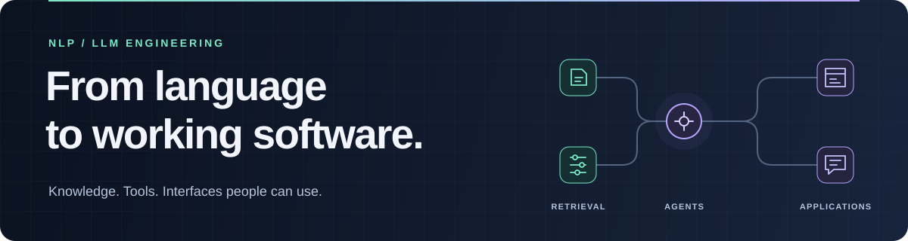

# Nehal Vaghasiya

**NLP Scientist · AI & LLM Engineering**

I build AI applications that connect language models with documents, tools, and usable interfaces. My work spans document Q&A, multi-agent workflows, structured data extraction, and reusable Python tooling, with foundations in machine learning and NLP.

**Interested in AI/LLM engineering and applied NLP roles.** [Let's connect on LinkedIn →](https://www.linkedin.com/in/nehalvaghasiya/)

**Start here:** [Agentic RAG](https://github.com/nehalvaghasiya/agentic-rag) for a full-stack AI application · [LangGraph Agents](https://github.com/nehalvaghasiya/langgraph-agents) for agent orchestration.

## Selected work

### 01 / Agentic RAG

**Ask questions across a document collection and inspect the sources behind the answer.**

Built a FastAPI and React application that turns uploaded PDFs and text files into project-specific knowledge bases, with a chat interface for exploring their contents.

- Implemented document ingestion, chunking, embeddings, and persisted vector search, followed by query rewriting and relevance grading.
- Streamed workflow progress, source snippets, and answer tokens through Server-Sent Events (SSE), making the retrieval process visible in the UI.
- Added request-level model configuration and an excerpt-based fallback when an LLM is unavailable.

`Python` `FastAPI` `React` `LangChain` `Embeddings` `SSE`

[Explore the project →](https://github.com/nehalvaghasiya/agentic-rag) · [Streaming implementation](https://github.com/nehalvaghasiya/agentic-rag/blob/main/backend/querying/stream.py) · [React interface](https://github.com/nehalvaghasiya/agentic-rag/tree/main/frontend/src)

### 02 / LangGraph Agents

**Compose specialist agents into research, writing, and document workflows.**

Built a modular agent framework with a shared agent base, reusable tools, and supervisors that route work between agents.

- Implemented graph-based tool-calling loops and teams for research and paper writing, with examples for search, RAG, summarization, and planning.
- Returned tool errors to the agent as messages so the workflow can respond to failed actions.
- Included tests for agent behavior and supervisor routing, with a GitHub Actions workflow configured for Python 3.11–3.13.

`Python` `LangGraph` `LangChain` `pytest` `GitHub Actions`

[Explore the project →](https://github.com/nehalvaghasiya/langgraph-agents) · [Agent implementation](https://github.com/nehalvaghasiya/langgraph-agents/blob/main/src/core/agents/base.py) · [Examples](https://github.com/nehalvaghasiya/langgraph-agents/tree/main/examples) · [Tests](https://github.com/nehalvaghasiya/langgraph-agents/tree/main/tests/core)

### 03 / Interview Bot

**Practice an interview tailored to a job description.**

Built a Streamlit application that generates role-specific questions, collects answers in a conversational interface, and provides AI-generated feedback.

- Managed questions, answers, and interview progress through session state.
- Made the job description and prompts configurable, with provider settings for OpenAI or local models through Ollama.

`Python` `Streamlit` `OpenAI API` `Ollama`

[Explore the project →](https://github.com/nehalvaghasiya/interview-bot) · [Interview workflow](https://github.com/nehalvaghasiya/interview-bot/blob/master/chatbot.py) · [Provider configuration](https://github.com/nehalvaghasiya/interview-bot/blob/master/utils.py)

## Tools and foundations

| Project | What I built |
| --- | --- |
| [**LLM Client Toolkit**](https://github.com/nehalvaghasiya/llm-client-toolkit) | A shared sync/async LLM client interface, JSON and Pydantic parsers, retries on invalid output, and adapters for LangChain, LlamaIndex, and PydanticAI. [Inspect the retry logic →](https://github.com/nehalvaghasiya/llm-client-toolkit/blob/main/llm_client/retry.py) |
| [**Web Scraper Agent**](https://github.com/nehalvaghasiya/web-scraper-agent) | A schema-driven extraction workflow using HTTPX, BeautifulSoup, PydanticAI, and Groq, with examples for products, blog posts, and job listings. [Inspect the extractor →](https://github.com/nehalvaghasiya/web-scraper-agent/blob/main/scraper.py) |
| [**ML/NLP Projects**](https://github.com/nehalvaghasiya/ml-nlp-projects) | A collection of learning and personal projects in classification, regression, sentiment analysis, spam detection, translation, and text summarization. [Browse NLP work →](https://github.com/nehalvaghasiya/ml-nlp-projects/tree/main/Natural%20Language%20Processing) |

Also built [**RecipeBot**](https://github.com/nehalvaghasiya/RecipeBot), a Streamlit chatbot that collects food preferences and generates recipe suggestions.

## Skills in practice

| Area | Technologies and techniques | See them in use |
| --- | --- | --- |
| Retrieval & agents | LangGraph, LangChain, embeddings, vector search, tool calling | [Agentic RAG](https://github.com/nehalvaghasiya/agentic-rag) · [LangGraph Agents](https://github.com/nehalvaghasiya/langgraph-agents) |
| Applications & APIs | Python, FastAPI, React, Streamlit, SSE | [Agentic RAG](https://github.com/nehalvaghasiya/agentic-rag) · [Interview Bot](https://github.com/nehalvaghasiya/interview-bot) |
| LLM integration | Sync/async clients, Pydantic, structured outputs, parser-aware retries | [LLM Client Toolkit](https://github.com/nehalvaghasiya/llm-client-toolkit) · [Web Scraper Agent](https://github.com/nehalvaghasiya/web-scraper-agent) |
| ML & NLP | PyTorch, classification, sequence models, text processing | [ML/NLP Projects](https://github.com/nehalvaghasiya/ml-nlp-projects) |

---

**Building a team around AI applications, retrieval, or agents?** I'd like to hear about the problems you're solving.

[Connect on LinkedIn →](https://www.linkedin.com/in/nehalvaghasiya/) · [Browse my repositories](https://github.com/nehalvaghasiya?tab=repositories)
